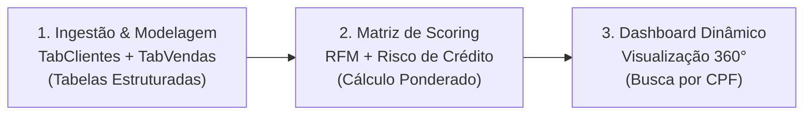

# Análise de Perfil do Cliente & Sistema de Scoring no Excel

## Resumo Executivo:

A concessão de crédito, a fidelização e a retenção de clientes dependem diretamente da capacidade de avaliar, de forma rápida e precisa, o comportamento transacional de cada comprador. Em muitas empresas com forte operação a prazo, a ausência de um mecanismo de escore automatizado gera alta exposição à inadimplência e perda de oportunidades de vendas personalizadas.

Neste projeto desenvolvido em **Microsoft Excel Avançado**, estruturei uma solução completa de inteligência de clientes: processei uma base com **1.003 transações** (totalizando **R$ 782.165,00** em faturamento) distribuídas entre **209 clientes**, implementei um **modelo matemático de scoring ponderado (RFM + Risco de Crédito)** e construí um **Dashboard Executivo Dinâmico** parametrizado por CPF. O sistema diagnostica instantaneamente a fidelidade e a saúde financeira do cliente, classificando-o nos perfis **Bronze**, **Prata**, **Ouro** ou **Diamante**.

Após analisar a carteira e identificar que **84% das vendas ocorrem a prazo** e que **26,7% das compras sofrem atraso médio de 25 dias**, recomendo à diretoria comercial e financeira a adoção de ações estratégicas:

1. **Diferenciação de Políticas de Crédito e Prazos por Escore** (protegendo a exposição aos R$ 267 mil faturados via boleto);
2. **Automação de Régua de Cobrança Preventiva** para redução do ciclo médio de atraso;
3. **Campanhas de Reativação Baseadas em Recência** para clientes com mais de 90 dias de inatividade;
4. **Programa de Benefícios e Upsell** direcionado à base Ouro (45,9%) e Diamante (1,0%).

---

### Problema de Negócio:

A carteira comercial da empresa possui alta dependência de compras a prazo (mais de 8 a cada 10 pedidos), gerando um desafio crítico de gestão de risco e fluxo de caixa. Sem uma ferramenta ágil de consulta individualizada, a equipe comercial levava tempo excessivo para avaliar o histórico do cliente e muitas vezes concedia prazos a perfis com histórico recorrente de atraso.

O desafio central deste projeto consistiu em responder: **Como consolidar os dados dispersos de vendas e clientes em um painel interativo no Excel, que calcule automaticamente o escore de fidelidade e risco de cada cliente através de seu CPF, fornecendo subsídios imediatos para negociações comerciais e decisões de crédito?**

```
┌────────────────────────────────────────────────────────────────────────┐
│                        DASHBOARD - PERFIL DO CLIENTE                  │
│                                                                        │
│ [ Nosso Cliente ]             [ Histórico com a Empresa ]             │
│ • CPF: 866.577.200-81         • É cliente há: 14 meses                │
│ • Nome: Henrique Jesus        • Não compra há: 1 mês (Recência)       │
│ • Perfil: OURO (83 pts)       • Faturamento Total: R$ 3.341,00        │
│                               • Ticket Médio: R$ 835,25 (4 compras)   │
│                                                                        │
│ [ Evolução das Compras ]       [ Meios & Prazos ]  [ Risco de Atraso ]  │
│ █ 12 meses (Gráfico Mensal)   █ Dinheiro/Cartão/  █ Atraso Médio:     │
│                                 Boleto & À Vista    0 dias/compra     │
└────────────────────────────────────────────────────────────────────────┘
```

---

### Metodologia:

O projeto foi executado em três etapas metodológicas estruturadas:



1. **Ingestão, Limpeza e Enriquecimento das Tabelas:**
   * Organização dos dados brutos em **Tabelas Estruturadas do Excel** (`TabClientes` com 210 cadastros e `TabVendas` com 1.004 registros).
   * Criação de colunas calculadas de inteligência temporal e de risco:
     * `Dias de Atraso`: cálculo condicional comparando `Data do Pagamento` vs. `Data do Vencimento`, com tratamento para títulos em aberto em relação à data-base (`06/05/2020`).
     * `Mês da Venda` e `Ano da Venda`: extração dinâmica para consolidação sazonal.
     * `À Vista?`: classificação lógica entre compras liquidadas no ato (`Sim`) vs. compras com vencimento futuro (`Não`).

2. **Desenvolvimento do Motor de Cálculo e Sistema de Scoring Multicritério (`Análise`):**
   * Criação da aba analítica de apoio com cálculo de agregação dinâmica parametrizada pelo CPF selecionado.
   * Emprego de fórmulas avançadas (`SUMIF`, `SUMIFS`, `COUNTIF`, `COUNTIFS`) e fórmulas matriciais para localizar a primeira e a última compra do cliente.
   * Estruturação do **Modelo de Escore Ponderado (100 pontos no total)** composto por 6 critérios:
     * **Atraso nos Pagamentos (Peso 30% - Maior Peso):** Avalia a pontualidade histórica em dias de atraso por compra.
     * **Valor Total das Compras (Peso 25%):** Volume monetário acumulado pelo cliente.
     * **Tempo de Relacionamento / Tenure (Peso 15%):** Quantidade de meses desde a primeira compra.
     * **Compra Média / Ticket Médio (Peso 15%):** Capacidade média de gasto por transação.
     * **Recência (Peso 10%):** Intervalo em meses desde a última compra realizada.
     * **Prazo de Pagamento (Peso 5%):** Bonificação para maior proporção de pagamentos à vista.
   * Matriz de enquadramento por faixas de pontuação via busca aproximada:
     * **Bronze:** 0 a 54 pontos | **Prata:** 55 a 64 pontos | **Ouro:** 65 a 89 pontos | **Diamante:** 90 a 100 pontos.

3. **Construção do Dashboard Executivo Interativo (`Dashboard`):**
   * Interface visual intuitiva com entrada dinâmica de CPF.
   * Resumo de identidade: busca de nome do cliente e badge dinâmico da categoria de perfil.
   * Três gráficos vinculados à camada analítica:
     1. *Evolução das Compras nos últimos 12 meses* (Gráfico de colunas temporal);
     2. *Meio de Pagamento* (Gráfico de barras horizontais: Dinheiro, Cartão, Boleto);
     3. *Forma de Pagamento* (Gráfico de colunas: À vista vs. À prazo).
   * Cartões de KPIs com destaque para fidelidade, ticket médio e atraso médio em dias.

---

### Habilidades & Técnologias Utilizadas:

* **Microsoft Excel Avançado:**
  * **Funções de Pesquisa & Referência:** `VLOOKUP` (PROCV com correspondência exata e aproximada por faixas de pontuação), `INDEX/MATCH` (ÍNDICE e CORRESP para identificar forma de pagamento predominante).
  * **Funções Estatísticas e de Agregação Condicional:** `SUMIF` (SOMASE), `SUMIFS` (SOMASES multicritério por CPF, ano e mês), `COUNTIF` (CONT.SE), `COUNTIFS` (CONT.SES para contagem de faturas com atraso `> 0`).
  * **Fórmulas Matriciais (Array Formulas):** Identificação automatizada da menor e maior data de compra vinculadas ao CPF.
  * **Funções Lógicas & Tratamento de Datas:** `IF` aninhado, `MONTH`, `YEAR`, `INT`, cálculo de diferenças temporais em meses com referência à data-base.
  * **Tabelas Estruturadas & Modelagem Relacional:** Referências estruturadas (`TabVendas[[#This Row], ...]`), integridade referencial e separação formal entre camada de dados brutos, camada analítica de cálculo e camada visual (Dashboard).
* **Análise de Negócios & Crédito:**
  * Modelagem de **Credit Scoring** e segmentação de clientes no modelo **RFM (Recência, Frequência e Valor Monetário)**.
  * Análise de inadimplência, ciclo financeiro de cobrança e mix de meios de pagamento.
* **Data Visualization & UI/UX:**
  * Construção de dashboard interativo com cartões de KPIs dinâmicos, padronização visual corporativa e gráficos dinâmicos de barras e colunas.

---

### Resultados & Recomendações de Negócio:

A implementação do dashboard transformou uma rotina que demandava conferências manuais em planilhas em uma consulta instantânea de **menos de 2 segundos por CPF**.

A análise agregada dos dados históricos revelou o panorama da empresa:

#### 📌 Métricas Gerais da Carteira:
* **Faturamento Total:** **R$ 782.165,00** em **1.003 vendas**.
* **Ticket Médio Global:** **R$ 779,83** por pedido.
* **Volume de Clientes Ativos:** **209 clientes únicos**.
* **Predomínio de Vendas a Prazo:** **84,0% das vendas** (843 transações) foram a prazo, contra apenas **16,0% à vista** (160 transações).
* **Concentração de Meios de Pagamento:**
  * **Cartão de Crédito:** R$ 327.361,00 (41,8% do faturamento | 419 vendas)
  * **Boleto Bancário:** R$ 267.447,00 (34,2% do faturamento | 348 vendas)
  * **Dinheiro:** R$ 187.357,00 (24,0% do faturamento | 236 vendas)
* **Indicadores de Inadimplência / Atraso:**
  * **26,7% das vendas (268 pedidos)** foram quitadas com atraso.
  * **Atraso médio:** **25,3 dias** (para faturas atrasadas), atingindo atraso máximo de **40 dias**.

#### 👥 Distribuição dos Perfis de Clientes (Scoring):

| Perfil | Faixa de Pontos | Total de Clientes | Participação (%) | Perfil Comportamental |
|---|:---:|:---:|:---:|---|
| 💎 **Diamante** | 90 - 100 pts | 2 | 1,0% | Clientes com altíssimo volume, fidelidade longa, zero atrasos |
| 🥇 **Ouro** | 65 - 89 pts | 96 | 45,9% | Principal motor de receita, compras frequentes e baixo histórico de atraso |
| 🥈 **Prata** | 55 - 64 pts | 68 | 32,5% | Clientes regulares, pontualidade moderada ou menor frequência de compra |
| 🥉 **Bronze** | 0 - 54 pts | 43 | 20,6% | Clientes de alto risco de atraso, baixa recência ou baixo tíquete |

```
Distribuição da Carteira por Perfil:
Ouro:     ███████████████████████ 96 clientes (45,9%)
Prata:    ████████████████ 68 clientes (32,5%)
Bronze:   ██████████ 43 clientes (20,6%)
Diamante: █ 2 clientes (1,0%)
```

#### 💡 Recomendações Estratégicas de Negócio:

1. **Segmentação da Política de Concessão de Crédito e Prazos:**
   * **Clientes Diamante e Ouro (46,9% da base):** Concessão de limites de crédito flexíveis, prazos diferenciados no boleto (30/60 dias) e canal de atendimento prioritário.
   * **Clientes Bronze (20,6% da base):** Restringir emissão de boletos sem garantias; condicionar vendas a cartão de crédito ou pagamento à vista com incentivo de pequenos descontos.

2. **Régua de Comunicação e Cobrança Preventiva:**
   * Dado que 26,7% dos pedidos sofrem atrasos que chegam a 40 dias, estruturar régua preventiva de cobrança para boletos (lembretes automáticos D-3, D-0 e D+2 via WhatsApp/E-mail) para reduzir o atraso médio de 25 dias para menos de 10 dias.

3. **Incentivo à Liquidação À Vista:**
   * Com 84% do faturamento concentrado a prazo, estruturar política comercial com desconto de 3% a 5% para pagamentos em dinheiro ou PIX, acelerando a entrada de caixa e reduzindo o risco de inadimplência.

4. **Régua de Reativação Comercial orientada à Recência:**
   * Utilizar o indicador *"Não compra a quantos meses?"* do dashboard para identificar clientes Ouro e Prata inativos há mais de 60 dias, acionando ofertas de reativação customizadas antes que entrem em zona de churn (abandono).

---

### Estrutura de Arquivos do Projeto:

```text
seção 16 - projeto perfil do cliente/
├── 📄 README.md                        # Documentação executiva completa do projeto
├── 📊 projeto-perfil-do-cliente.xlsx   # Pasta de trabalho Excel com Dashboard e Modelo de Scoring
├── 📑 projeto-perfil-do-cliente.pdf    # Especificação conceitual e instruções do projeto
├── 📑 base-dados-1.xlsx                # Base transacional bruta (dados-vendas)
├── 📑 base-dados-2.xlsx                # Base cadastral bruta (dados-clientes)
└── 🖼️ logo-layout.png                  # Ativo visual de logotipo do layout do dashboard
```

---

### Próximos Passos:

1. **Lista Suspensa Dinâmica de Seleção:** Implementar validação de dados com menu drop-down inteligente e busca autocompletar para o campo CPF no Dashboard, eliminando necessidade de digitação.
2. **Migração do Modelo para Power BI:** Construir modelo semântico em Power BI com DAX e Star Schema, permitindo análises comparativas da carteira inteira simultaneamente e filtros cruzados por região e meio de pagamento.
3. **Automatização via ETL / SQL:** Integrar as bases relacionais diretamente a um banco de dados SQL para atualização automática diária das transações e reclassificação de score em tempo real.

---

### Autor

Projeto desenvolvido por **Giovany César** no âmbito do curso **Excel Completo do Básico ao Avançado** do Prof. Nélio Alves.
